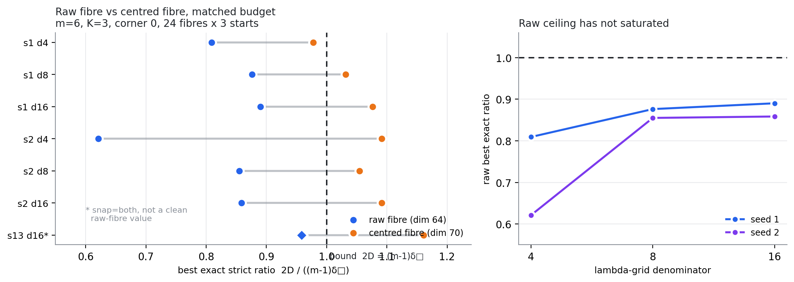

# Report 5 — D6 Product-Reference / Mixed-Difference Chain
## Append-only addendum, 5 September 2026 (evening session)

**Status of this addendum:** append-only. Nothing above section 24A is edited,
retracted or deleted. Every claim below is labelled with the strongest evidence
class the current corpus actually supports, and every demotion is written out as
the struck formula plus its reason.

**Scope of this session:** the centred rank-one rescue of D6 moved from an exact
rational counterexample to a Lean-audited refutation; a new invariant (raw local
contrast rank one) was defined and its structure theorem proved and
axiom-audited; and a matched-budget A/B falsification campaign separated the two
hypotheses numerically. Three of my own working hypotheses were demoted by the
experiments that tested them; they are recorded below with the same weight as the
promotions.

---

## 25. Promotion: the centred rank-one conditional is now PROVED FALSE

Report 5 as delivered, and `PROVENANCE_AND_EVIDENCE_CLASS_20260905.md` §D6,
carried this non-promotion:

> ~~`LeanD6StrictTwoProfileRankOneM6CounterexampleV2.lean` is present but the
> current audited extraction contains no matching `.olean`. Therefore the
> addendum does not label the centered rescue PROVED FALSE in Lean.~~

**That line is now stale.** The module compiles.

| item | value |
|---|---|
| `LeanD6StrictTwoProfileRankOneM6CounterexampleV2.olean` | present, 28,733,696 bytes, newer than its `.lean` |
| `sorry` / `admit` in source | 0 |
| axiom audit | `AxiomAuditD6FalsificationV1.lean`, 16 theorems |
| result | every theorem: `[propext, Classical.choice, Quot.sound]` |

**Class transition:** `EXACT_RATIONAL_COUNTEREXAMPLE_INDEPENDENTLY_RECOMPUTED`
→ **`PROVED_FALSE_LEAN4_AXIOM_AUDITED`**.

The refuted statement is

$$\texttt{RankOneDecisionInteractionConstantAtMost}\ \texttt{witnessCell}\ 5,$$

that is: `AllCoordinatesInteractionContrastRankOne`$(q,F)$ does **not** imply
$2D \le (m-1)\delta_\square$, at $m=6$, $K=3$, corner reference.

### 25.1 Why this is not a vacuous refutation

Nine of the sixteen audited theorems are the **hypotheses** of D6, proved for the
witness rather than assumed. This is the part that makes the negation carry
content:

| audited hypothesis | what it establishes |
|---|---|
| `cornerQ6_nonnegative`, `cornerQ6_normalized` | the reference is a genuine nonnegative normalised product measure |
| `witnessWorld_unitInteraction` | `UnitInteractionBound witnessWorld` |
| `witness_allCoordinatesRankOne` | every coordinate is centred rank one |
| `witness_atMostTwoProfiles` | at most two interaction profiles per coordinate |
| `witness_strictTopC` | the Top-C selection is **strict**, not tie-decided |
| `witness_balanced`, `witness_cell_valid` | the cell is balanced and `Valid` |
| `witness_rankOneNormalizedBalanced` | the world is in the class the law quantifies over |

A negation of premises nobody can satisfy would be worthless. These premises are
satisfied, in Lean, by the same witness.

### 25.2 What this does **not** say

- It refutes the conditional at $m=6$, $K=3$, corner reference. It does **not**
  say the decision bound fails for every $m$, nor under other references.
- It says nothing about D6-prime (§27), which remains OPEN.
- It does not touch `D6.world_approximation` or `D6.symmetric_difference`.
- The still-quarantined half-factor conjecture
  $L_F(S_C)-L_F^\star \le \tfrac12 (m-1)\delta_\square$ is untouched; it remains
  the one D6 `sorry`.

**Artifact:** `research/d6_contrast_rank_falsification/D6_CENTRED_RANKONE_PROVED_FALSE_20260905.json`.

---

## 26. New formal content: the raw local contrast invariant

The reason the centred conditional fails is structural, not accidental. The
centred profile

$$\psi_{i,u}^{u_0}(z) = \big[F(z_{i\leftarrow u}) - F(z_{i\leftarrow u_0})\big]
 - \big[Q_i^q(u) - Q_i^q(u_0)\big]$$

is a **projection**: it discards the additive layer. Every recorded counterexample
lives in exactly the layer it discards. The invariant that does not discard it is
the **raw** local contrast

$$\rho_{i,u}(z) = F(z_{i\leftarrow u}) - F(z_{i\leftarrow u_0}),$$

and `RawLocalContrastRankOne` at coordinate $i$ says the (action × context) matrix
$[\rho_{i,u}(z)]$ has rank at most one.

### 26.1 Proved, axiom-audited

`AxiomAuditRawRouteV1.lean`, 12 theorems, all
`[propext, Classical.choice, Quot.sound]`; 0 `sorry` across five modules.

| theorem | content | class |
|---|---|---|
| `rawLocalContrastRankOne_iff_minors_zero` | raw rank one $\iff$ every $2\times2$ minor of the raw contrast matrix vanishes. **Witness-free**: no anchor witness, no reference measure, no factorisation | PROVED |
| `rawLocalContrastRankOne_iff_aligned` | raw $\iff$ centred rank one **and** $\alpha = \kappa\lambda$ — the exact gap between the two invariants | PROVED |
| `not_rawLocalContrastRankOne_of_misaligned` | $\mu_i(u,v)\ne 0$ together with a context-separating $h$ refutes raw rank one | PROVED |
| `binary_allCoordinatesRawLocalContrastRankOne` | $K=2 \Rightarrow$ raw rank one at every coordinate, **for every $F$, unconditionally** | PROVED |
| `rawLocalContrastRankOne_interpolation` (★) | $F(z_{i\leftarrow u}) = (1-\theta_i(u))F(z_{i\leftarrow u_0}) + \theta_i(u)F(z_{i\leftarrow r_i})$ | PROVED |
| `inactive_coordinate_constant` | an inactive coordinate is one $F$ does not depend on | PROVED |
| `rawRankOne_corner_reconstruction` | $F$ is the tensor-product interpolation of its $2^m$ corner values | PROVED |
| `bernstein_mem_monomialSpan` | Bernstein weights lie in the span of the subset monomials | PROVED |
| `rawRankOne_exists_multiaffine_coefficients` | $F(x)=\sum_S c_S \prod_{i\in S}\theta_i(x_i)$ | PROVED |
| `rawRankOne_normal_form_const_plus_interaction` | $F = \text{const} + P(\theta)$, $P$ with no constant term | PROVED |
| `rawRankOne_active_covered_by_rawMonomialFibre` | one-way coverage of the active stratum by the searched fibres | PROVED |

**Modules:** `LeanD6RawLocalContrastRankOneV1`, `…ReconstructionV1`,
`…MultiaffineV1`, `…NormalFormV1`, `…VarietyCoverageV1`.
**Artifact:** `research/d6_raw_contrast_rank/RAW_RANKONE_NORMAL_FORM_PROVED_20260905.json`.

### 26.2 The load-bearing simplification

(★) is a three-line corollary of the minor identity. Its significance is that it
**eliminates the existential factorisation** from every downstream statement:
$\theta_i(u) := \rho_{i,u}(z^\star)/\rho_{i,r}(z^\star)$ is built from $F$ alone.
No `Classical.choose` on a factorisation witness, no uniqueness lemma, no gauge
lemma. The whole reconstruction then runs on plain finite algebra.

### 26.3 Novelty boundary — stated, not assumed

Per the standing novelty gate, the classical content is named:

- The corner reconstruction formula is the **classical multilinear extension**
  (Owen 1972; standard multilinear interpolation on the hypercube).
- The monomial form with $\beta_S = \sum_{T\subseteq S}(-1)^{|S|-|T|}F(c_T)$ is the
  **Möbius transform on the Boolean lattice** (Rota 1964; Harsanyi dividends 1963).
- "A function affine in each variable separately is determined by its corner
  values" is folklore.

*(Attributions recalled, not verified against the literature. Check before citing —
consistent with the existing literature-boundary discipline in §19 and in the
provenance ledger.)*

The CIG novelty is elsewhere, and it is these four things:

1. `RawLocalContrastRankOne` as an invariant, and the characterisation
   raw $\iff$ centred $\wedge\ \alpha=\kappa\lambda$;
2. **linearity of the raw fibre** — for fixed $\theta$, raw rank one is a *linear*
   condition on $F$, so the raw variety is a union of linear subspaces (§28.1);
3. $K=2 \Rightarrow$ raw, unconditionally — an explanation of the alphabet phase
   with no analytic input;
4. using a classical normal form as a **coverage certificate** for a falsification
   search. The theorem is old; the role it plays is not.

**Choice of proof route.** The span-membership formulation was chosen over the
Möbius-coefficient formulation *for Lean cost only, not for novelty*: it turns the
Bernstein→monomial step into a two-term recursion closed under
`Submodule.sub_mem`, with no signs, no binomial coefficients and no incidence
algebra, and the explicit coefficients then fall out of
`Submodule.mem_span_range_iff_exists_fun` in ten lines.

---

## 27. D6-prime: the repaired conditional, and its first falsification campaign

$$\textbf{D6}'\colon\quad
\texttt{AllCoordinatesRawLocalContrastRankOne}(F)\ \wedge\ \texttt{StrictTopC}
\ \Longrightarrow\ 2D \le (m-1)\delta_\square .$$

**Class: OPEN.** Nothing in §26 bears on whether it is true.

### 27.1 Design: A/B with a positive control

The single change from the campaign that kills D6 is `--fiber-kind`. Same script,
seed, corner, fibre count, optimizer, snapping and StrictTopC gate. The centred
arm is a **positive control**: it must find a violation, and it does, reproducing
the recorded record `B3small_m6_d16_s13` to the digit:

$$\frac{13377550871789472669355898295037}{11521333580748990157598809214010}
 = 1.161111322576584\ldots$$

Absence of a counterexample in a lower-bound search is never proof. It is
interpretable **only** against a control that succeeds at the same budget. That
is why the control is part of the design and not an afterthought.

### 27.2 Result

| seed | den | RAW | CENTRED (same cell) | Δ |
|---|---|---|---|---|
| 1 | 4 | 0.809202 | 0.977866 | −0.169 |
| 1 | 8 | 0.876295 | **1.031680** KILLED | −0.155 |
| 1 | 16 | 0.890273 | **1.076456** KILLED | −0.186 |
| 2 | 4 | 0.621037 | **1.091307** KILLED | −0.470 |
| 2 | 8 | 0.855053 | 1.054733 | −0.200 |
| 2 | 16 | 0.858484 | **1.091307** KILLED | −0.233 |

**RAW: 0/6 KILLED, max 0.8903. CENTRED on the same cells: 4/6 KILLED, max 1.0913.**
Paired cell by cell, raw is below centred in **6 of 6**, with no exception.

### 27.3 Explicit non-claims

- A per-fibre float search maximises a **lower** bound and is path dependent.
  This is countersearch evidence, not proof.
- The raw ceiling **has not saturated**: it rises monotonically with the
  $\lambda$-grid denominator (seed 1: $0.8092\to0.8763\to0.8903$; seed 2:
  $0.6210\to0.8551\to0.8585$). $0.8903$ is not a limit value. The saturation test
  at denominators 32 and 64 is the decisive next experiment.
- One corner, two seeds, three denominators, 24 fibres. Six cells.
- The exact recheck in the search script verifies **centred** rank one, not raw
  rank one. Raw-arm witnesses are in the fibre by construction of the basis, not
  by an independent certificate. Extending the recheck is open work.

**Artifact:** `research/d6_contrast_rank_falsification/AB_RAW_VS_CENTRED_20260905.json`,
`RAWsweep_m6_d{4,8,16}_s{1,2}.json`.

---

## 28. New exact structural measurements

### 28.1 Raw fibre dimension — exact, and matching the normal form

For fixed $\theta$, raw rank one is a **linear** condition on $F$ (every spanning
column carries the same $\theta_i$), so the fibre is a linear subspace of
dimension

$$\dim V^{\rm raw}_\phi = \underbrace{1}_{\text{const}} + \underbrace{m}_{\phi_i}
 + \underbrace{2^m-1-m}_{|S|\ge 2} = 2^m,$$

against $\dim V_\lambda = 1 + m(K-1) + (2^m-1-m)$ for the centred fibre. The
codimension is $m(K-2)$: the centred fibre carries $K-1$ free additive degrees of
freedom per coordinate, the raw fibre exactly one.

Verified exactly (rank over $\mathbb{Q}$, plus closure under addition, plus a
probe that the dropped indicator directions genuinely break raw rank one):

| $m$, $K$ | $\dim V^{\rm raw}$ | $\dim V_\lambda$ | codim | predicted $m(K-2)$ |
|---|---|---|---|---|
| 4, 3 | 16 | 20 | 4 | 4 ✓ |
| 6, 2 | 64 | 64 | **0** | 0 ✓ |
| 6, 3 | **64** | **70** | **6** | 6 ✓ |

The $K=2$ row is `binary ⇒ raw` seen from the dimension side — an independent
confirmation of the Lean theorem. The centred value 70 matches the previously
recorded `B3fiberdim_rankone_m6_K3.json`.

**Script:** `scripts/verify_raw_fiber.py`.
**Artifacts:** `E1_rawfiber_m6_K3.json`, `E1_rawfiber_m6_K2.json`.

### 28.2 Binary alphabet: unconstrained search finds nothing

At $K=2$ the rank-one constraint is **vacuous**: $\dim V_\lambda = 1+6+57 = 64 = 2^6$
is the whole function space. So a single fibre search at $K=2$ sweeps every binary
world, not a slice. Result: no counterexample, best ratio $0.3584$.

**Artifact:** `B3binary_m6_K2.json`.

### 28.3 Misalignment annotation of the whole counterexample corpus

Every recorded D6 witness world was annotated with the **witness-free** per-coordinate
raw contrast rank (exact rank over $\mathbb{Q}$), rather than with $\mu$, because
$\mu$ is only equivalent to raw rank one when the context factor is non-constant
(§29.4). 72 witness records.

- `n_centred_rank_violating = 0` everywhere — independent confirmation that the
  whole falsification corpus genuinely satisfies centred rank one.
- **14 of 14 violating witnesses have $n_{\rm misaligned}\ge 1$.** No exception.
- The only witness with $n_{\rm misaligned}=0$ is the binary one, at ratio 0.358.

Misalignment is therefore **necessary for violation across the entire recorded
corpus** — which is exactly the content of D6-prime, seen from the data side.

The decision layer was recomputed **per witness** in exact rational arithmetic
(a mirror of `FloatModel.evaluate`), because the artifacts record one
artifact-level ratio while storing up to three different witness worlds beside
it; attributing the one ratio to all three was a real methodological fault in the
first pass. The recomputation reproduces the flagship integer witness exactly:
$131/130$.

**Script:** `scripts/annotate_misalignment.py`.
**Artifact:** `MISALIGNMENT_ANNOTATION_20260905.json`.

---

## 29. Demotions

Recorded with the same weight as the promotions, per the evidence discipline.
Each is written out and struck, with its reason.

### 29.1 The proposed misalignment-corrected law — DEMOTED

$$\sout{\;2D \;\le\; (m-1)\delta_\square \;+\; c\cdot \#\{i : \mu_i \ne 0\}\cdot\delta_\square\;}$$

**Reason.** Proposed on the strength of the minimal integer witness having exactly
one misaligned coordinate and exactly one unit of excess ($131$ vs $130$). The
exact per-witness annotation does not support it. The maximum excess$/\delta_\square$
is monotone in $n_{\rm misaligned}$ at the envelope ($n{=}1:0.0385$, $n{=}2:0.274$,
$n{=}5:0.715$, $n{=}6:0.762$), but $n{=}6$ also spans down to $-2.197$, the sample
is severely biased (the search maximises ratio, it does not sweep $n$), and there
is no cell where the bound is tight. It is a **fitted envelope, not a law**: it
forbids nothing that is observed.

**What survives:** the qualitative statement of §28.3 — misalignment is necessary
for violation, 14/14 — which is D6-prime, not a quantitative correction term.

### 29.2 "The raw fibre makes Top-C ties generic" — KILLED

**Claim as made.** The preliminary raw-fibre run rejected 18 of 28 leads for Top-C
ties; I proposed that inside the raw fibre the per-coordinate additive part is
forced affine in $\phi_i$, so response spans lose their free scale and ties become
structurally more common — which would have meant the low raw ratio was a
search-dynamics artifact.

**Test.** Fix $\phi$; take orthonormal $Q_{\rm raw}$ and the complement $E$ of the
raw fibre inside the centred fibre; sample
$F(s) = Q_{\rm raw}a + s\,E\,b$ with $a,b$ iid standard normal. $s=0$ is the raw
fibre, $s=1$ the centred fibre, same $\phi$, same sample size, same random stream.
No optimizer anywhere in the loop, so the measurement cannot be confounded by
search behaviour.

| $s$ | 0 | 0.05 | 0.15 | 0.4 | 1.0 |
|---|---|---|---|---|---|
| tie rate ($\varepsilon = 0.01$) | 0.2608 | 0.2642 | 0.2675 | 0.2667 | 0.2650 |
| exact tie rate | 0 | 0 | 0 | 0 | 0 |

**Flat. The hypothesis is refuted.** The tie rejections were an artifact of lead
selection, not of the geometry. The corrective action was therefore to the
optimizer and the lead pipeline, not to the fibre.

*Secondary observation worth keeping:* isotropic sampling reaches ratio $\approx 0.17$
in **both** fibres while optimisation reaches $1.16$. The violating region has
effectively measure zero, so distributional sampling says nothing about the
supremum — only directed search does.

**Artifact:** `TOPC_TIE_RATE_m6_K3.json`. **Script:** `scripts/run_topc_tie_frequency.py`.

### 29.3 "The normal form is an exhaustiveness certificate" — DEMOTED

$$\sout{\;\text{RawRankOne} \Rightarrow F = P(\theta)\ \text{makes the raw-fibre search exhaustive}\;}$$

**Reason.** What is proved is that for each $\phi$ the raw-rank-one worlds form
exactly a linear subspace of dimension $2^m$, and (one-way, `VarietyCoverage`) that
every active raw-rank-one world lies in *some* searched monomial fibre. But the
search enumerates a **finite rational grid** of $\phi$ (denominator 16, 24 fibres).
Coverage in $\phi$ remains a sampling argument, not a proof.

**Replacement statement:** the normal form makes the *fibre parameterisation*
exact; it does not make the *search* exhaustive. `VarietyCoverageV1`'s own
docstring already refuses the equality-of-varieties claim, and that refusal is
correct.

### 29.4 $\mu_i(u,v)=0 \iff$ raw rank one — DEMOTED to one direction

$$\sout{\;\mu_i(u,v) = \alpha_i(u)\lambda_i(v)-\alpha_i(v)\lambda_i(u) = 0
 \iff \text{RawLocalContrastRankOne}\;}$$

**Reason.** $\rho_{i,u} = \alpha_i(u)\cdot 1 + \lambda_i(u)\cdot h_i$, so
collinearity of the pairs $(\alpha_i(u),\lambda_i(u))$ is equivalent to
$\dim\operatorname{span}\{\rho_{i,u}\}\le 1$ **only when $1$ and $h_i$ are linearly
independent**, i.e. $h_i$ non-constant. When $h_i$ is constant, $\lambda$ is not
determined by $F$ and $\mu$ carries no information.

**What holds, and is proved:**
- $\mu \equiv 0 \Rightarrow$ raw rank one — **unconditional**
  (`rawLocalContrastRankOne_of_alignment_determinant`).
- raw rank one $\Rightarrow \mu \equiv 0$ requires the non-degeneracy hypothesis,
  and it is written into the statement, not hidden
  (`not_rawLocalContrastRankOne_of_misaligned`, hypothesis $h\,x \ne h\,y$).

The downstream falsifier does not depend on $\mu$ at all: it is the witness-free
minor obstruction.

### 29.5 The raw value $0.9585$ — DEMOTED as a raw-fibre measurement

**Reason.** That run used `--snap both`. The `project` snapping branch chases the
value space and can leave $V^{\rm raw}_\phi$, so the reported world need not
satisfy the hypothesis. Every clean run with `--snap coefficients` tops out at
$\le 0.8903$. The corrective is `--snap coefficients` for the raw arm.

**Caveat on this demotion:** the comparison is **confounded** — $0.9585$ is seed 13,
the clean runs are seeds 1 and 2. The clean test is seed 13 with
`--snap coefficients`, and it is open.

**Consequence for §27:** the "only 4.15% headroom" warning attached to the first
A/B result was itself based on the inflated value; on clean runs the margin is
$\approx 11\%$. This does not change the OPEN status of D6-prime.

---

## 30. Equation lineage table — this session's additions

| Stage | Equation / claim | Current status | Reason |
|---|---|---|---|
| P13 | `RankOneDecisionInteractionConstantAtMost cell 5` | **PROVED FALSE** | V2 compiles; 16/16 axiom audit; 9 hypotheses proved |
| P13 | $\rho_{i,u}(z) = F(z_{i\leftarrow u}) - F(z_{i\leftarrow u_0})$ | **ACTIVE DEFINITION** | raw contrast; keeps the layer centring discards |
| P13 | raw $\iff$ every $2\times2$ raw minor vanishes | **PROVED** | witness-free characterisation |
| P13 | raw $\iff$ centred $\wedge\ \alpha=\kappa\lambda$ | **PROVED** | the exact gap between the invariants |
| P13 | $K=2 \Rightarrow$ raw rank one | **PROVED** | unconditional, every $F$ |
| P13 | (★) slice interpolation | **PROVED** | removes the existential factorisation |
| P13 | $F = \text{const} + P(\theta)$ | **PROVED** | active stratum only |
| P13 | $\dim V^{\rm raw}_\phi = 2^m$, codim $m(K-2)$ | **EXACT, VERIFIED** | rank over $\mathbb{Q}$, three $(m,K)$ points |
| P13 | corner reconstruction / Möbius form | **CLASSICAL, NOT NOVEL** | Owen 1972; Rota 1964 |
| P13 | D6-prime: raw + StrictTopC $\Rightarrow (m-1)\delta_\square$ | **OPEN** | 6/6 cells raw < centred; ceiling not saturated |
| P13 | ~~$2D \le (m-1)\delta + c\,n_{\rm mis}\,\delta$~~ | **DEMOTED** | fitted envelope, forbids nothing observed |
| P13 | ~~raw fibre makes Top-C ties generic~~ | **KILLED** | tie rate flat 0.2608→0.2650 |
| P13 | ~~normal form ⇒ search exhaustive~~ | **DEMOTED** | finite $\phi$ grid; coverage is one-way |
| P13 | ~~$\mu = 0 \iff$ raw~~ | **DEMOTED to $\Leftarrow$** | needs $h$ non-constant |
| P13 | ~~raw best ratio $= 0.9585$~~ | **DEMOTED** | `snap both` can leave the fibre |

---

## 31. Open work, in order of information value

1. **Raw saturation test.** Denominators 32 and 64, seeds 1, 2, 13. The raw
   ceiling is still climbing; whether it crosses 1 is the question that decides
   D6-prime. Everything else is secondary to this.
2. **Seed-13 confound.** Rerun seed 13 raw with `--snap coefficients` to close §29.5.
3. **Extend the exact recheck to verify raw rank one** directly (per-coordinate raw
   contrast matrix rank $\le 1$); the exact-rank code already exists in
   `scripts/annotate_misalignment.py`.
4. **Lemma 6a — inactive coordinates.** The global normal form still carries the
   all-coordinates-active hypothesis. The route is a canonical representative via
   `Classical.choose` on `ActiveCoordinate` plus the convention $\theta_i \equiv 0$
   on inactive coordinates, at which point (★) holds unconditionally and degenerates
   to `inactive_coordinate_constant`. Estimated ~180 lines, and it *replaces* rather
   than extends the current modules.
5. **Reverse fibre inclusion.** `VarietyCoverageV1` proves coverage one way and
   explicitly refuses the equality. Closing it needs: every scalar-multiaffine
   fibre point with a zero-anchor coefficient is raw rank one.
6. Not blocking anything: the half-factor conjecture and its single `sorry` are
   untouched by this session.

---

## 32. Instrument corrections made this session

Recorded because they change how future numbers must be read.

1. **`--fiber-kind {centred,raw}`** added to
   `scripts/run_d6_direct_rankone_linear_fiber_search.py`. The raw fibre takes its
   own closed-form basis; the numerical nullspace route computes $V_\lambda$ and is
   not usable for it. Verified: same $\lambda$ gives rank 70 (centred) and 64 (raw).
   The centred arm reproduces the recorded record bit-for-bit, so the flag does not
   perturb the proven search path.
2. **Observatory** — `D6.rank_one_geometry` status note moved from
   "rank-one sufficiency conjecture OPEN" to REFUTED with the reason;
   `D6.decision_interaction_complexity` updated to say the centred-rank-one
   conditional is falsified and the open conditional is now the raw one. A new
   equation `D6.raw_contrast_rank_one` was declared and is emitted by
   `observatory/chains/d6.py` over the same contexts and anchor as the centred
   probe, with a `misaligned` flag (= centred rank one **and** raw rank > 1) —
   exactly what D6's hypothesis could not see. 49/49 observatory tests pass.
3. **A0 dependency sweep.** `RankOneDecisionInteractionConstantAtMost` is used as a
   hypothesis in **zero** theorems anywhere in the corpus; it appears only in its
   own definition module and in the counterexample that refutes it. **No downstream
   rot from the falsification.**
4. Repository debris found, not removed:
   `work/p13_conjectures/work/p13_conjectures/LeanD6StrictTwoProfileRankOneM6CounterexampleV2.lean`
   — a nested duplicate that **differs** from the live file and can be compiled by
   mistake.

---

## 33. Sources used in this addendum

### Internal formal sources
- `work/p13_conjectures/LeanD6StrictTwoProfileRankOneM6CounterexampleV2.lean/.olean`
- `work/p13_conjectures/AxiomAuditD6FalsificationV1.lean`
- `work/p13_conjectures/LeanD6RawLocalContrastRankOneV1.lean/.olean`
- `work/p13_conjectures/LeanD6RawRankOneReconstructionV1.lean/.olean`
- `work/p13_conjectures/LeanD6RawRankOneMultiaffineV1.lean/.olean`
- `work/p13_conjectures/LeanD6RawRankOneNormalFormV1.lean/.olean`
- `work/p13_conjectures/LeanD6RawRankOneVarietyCoverageV1.lean/.olean`
- `work/p13_conjectures/AxiomAuditRawRouteV1.lean`

### Internal empirical sources
- `research/d6_contrast_rank_falsification/D6_CENTRED_RANKONE_PROVED_FALSE_20260905.json`
- `research/d6_raw_contrast_rank/RAW_RANKONE_NORMAL_FORM_PROVED_20260905.json`
- `research/d6_contrast_rank_falsification/AB_RAW_VS_CENTRED_20260905.json`
- `research/d6_contrast_rank_falsification/ABsweep_{centred,raw}_m6_K3_s13_d16.json`
- `research/d6_contrast_rank_falsification/RAWsweep_m6_d{4,8,16}_s{1,2}.json`
- `research/d6_contrast_rank_falsification/E1_rawfiber_m6_K{2,3}.json`
- `research/d6_contrast_rank_falsification/MISALIGNMENT_ANNOTATION_20260905.json`
- `research/d6_contrast_rank_falsification/TOPC_TIE_RATE_m6_K3.json`
- `research/d6_contrast_rank_falsification/B3binary_m6_K2.json`
- `research/d6_contrast_rank_falsification/B3small_m6_d{4,8,16}_s{1,2,3,5,8,13,21,34}.json`

### Scripts added or modified
- `scripts/verify_raw_fiber.py` (new)
- `scripts/annotate_misalignment.py` (new)
- `scripts/run_topc_tie_frequency.py` (new)
- `scripts/run_d6_fiber_ab_search.py` (new; **superseded** by the `--fiber-kind`
  flag on the proven script — it plateaued at exactly 0.8 and is structurally weaker)
- `scripts/run_d6_direct_rankone_linear_fiber_search.py` (`--fiber-kind` added)
- `observatory/equations.py`, `observatory/chains/d6.py`

### External literature
- Owen (1972), *Multilinear Extensions of Games*.
- Rota (1964), Möbius inversion on incidence algebras; Harsanyi (1963), dividends.
- Ferrere et al. (2026), *Exact Functional ANOVA Decomposition for Categorical
  Inputs Models* — carried forward from §19, unchanged by this session.
